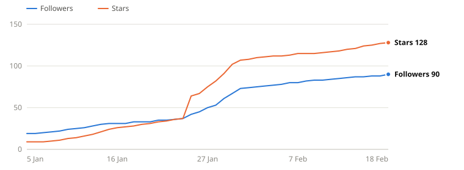
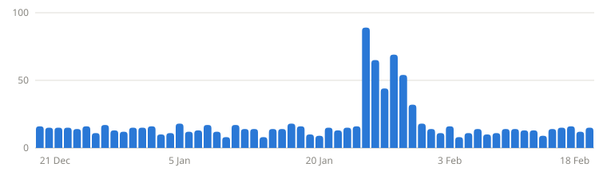

# GitHub Follower Board

How many people follow, star, watch and visit your GitHub projects, day by day, on one page that updates itself.

A small GitHub Action counts the numbers for every public repository of your account or organisation once a day
and writes them into the README of a repository of your own, with charts. It runs on GitHub's own computers: no
server, no sign-up, no outside service, no packages to install.

<picture><source media="(prefers-color-scheme: dark)" srcset="docs/example-growth-dark.svg"></picture>

<picture><source media="(prefers-color-scheme: dark)" srcset="docs/example-visitors-dark.svg"></picture>

_Example charts with made-up numbers. Each chart comes in a light and a dark version, and GitHub shows the one that
matches the reader's theme._

## What your page shows

- Followers, stars and watchers in total, plus visitors in the last 14 days
- The change since yesterday, and once a week has passed, since a week ago
- Followers and stars day by day, and visitors per day for the last 60 days
- Each public repository with its stars, watchers, forks, visitors and views
- Where visitors came from
- Who followed or starred in the last week

GitHub forgets visitor numbers after 14 days. The board saves them every day in `data/history.json`, so your
history keeps growing.

## Set it up (about 3 minutes)

1. Click **Use this template**, then **Create a new repository**. As the owner, pick the account or organisation
   you want counted. Name it, for example, `follower-board` (GitHub keeps the name `followers` for itself), choose
   **Private**, and create it.
2. In your new repository, open **Actions**, choose **Daily count** and click **Run workflow**. About a minute
   later, the repository's front page is your board.

From then on it counts every day at 15:40 UTC. For another time, change the `cron` line in
`.github/workflows/daily.yml`.

## Visitor numbers (optional)

GitHub shows visitor numbers only to people who can change a repository, so the count needs a read-only key:

1. Open this [pre-filled token page](https://github.com/settings/personal-access-tokens/new?name=Follower+board&description=Read-only+visitor+numbers+for+my+follower+board&expires_in=none&administration=read).
   Under **Resource owner**, pick the account or organisation; under **Repository access**, pick
   **All repositories**. The link already sets **Administration: Read-only**, the only permission needed.
2. Click **Generate token** and copy the key.
3. In your board repository, open **Settings**, then **Secrets and variables**, then **Actions**, then
   **New repository secret**. Name it `TRAFFIC_TOKEN`, paste the key and save.

The key can only read. If it expires or is deleted, the count still runs and the page says that visitor numbers
stopped.

## Settings (optional)

Under **Settings**, then **Secrets and variables**, then **Actions**, then **Variables**:

| Variable | What it changes | If not set |
|---|---|---|
| `BOARD_TIMEZONE` | Time zone for the dates on the page, such as `Asia/Kolkata` or `Europe/Berlin` | `UTC` |
| `BOARD_TITLE` | The name at the top of the page | The owner's display name |

## Good to know

- Only public repositories are counted, and the board itself is left out.
- Up to 5,000 followers, and up to 5,000 stars per repository, are read each day.
- A daily count takes well under a minute of GitHub Actions time.
- GitHub pauses scheduled runs in a public repository after 60 days without activity there. A private board
  avoids that.
- Nothing leaves GitHub: the count reads GitHub's API with the token GitHub gives each run (plus your visitor key,
  if you add one) and writes only to your board repository.

## Files

| File | What it does |
|---|---|
| `collect.mjs` | The count: reads the numbers, keeps the history, draws the charts and writes `README.md`. Node.js 18 or newer, no packages. |
| `.github/workflows/daily.yml` | Runs the count every day and saves the result. |
| `docs/` | The example charts on this page. |

---

Designed by [IndusLabs](https://indus-labs.com)
